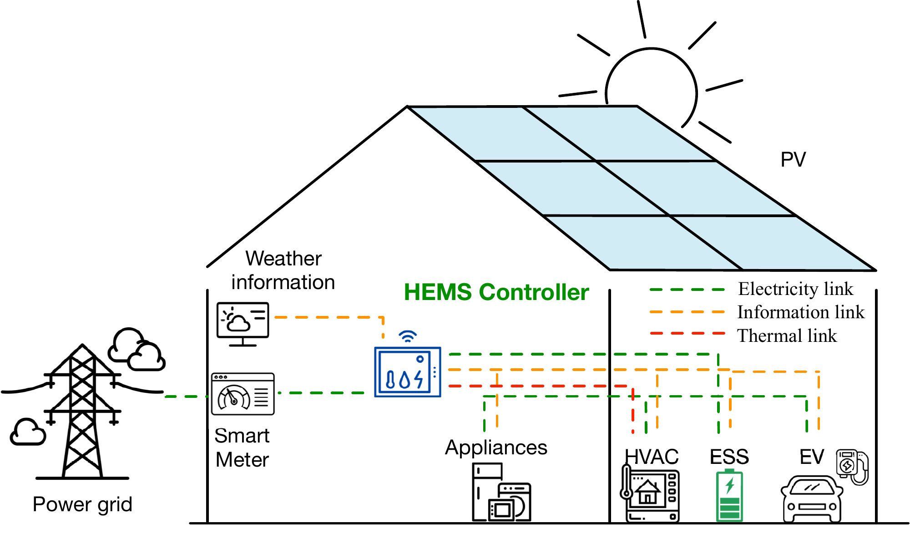
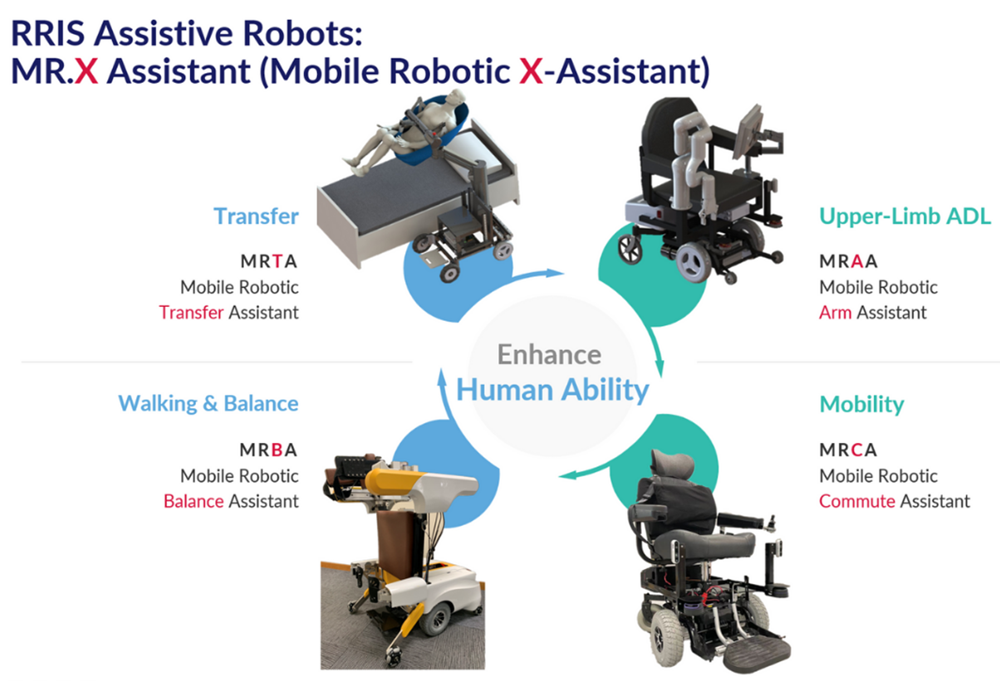

##  Ongoing Projects 

---------------
 
[//]: # (![MSCA.png]&#40;../images/MSCA.png&#41;)

* Integrating reinforcement learning and predictive control for smart home energy management, European Commission, Project ID: EC/HE/101110832
  * Chalmers University of Technology, Sweden

To achieve carbon neutrality and reduce dependence on fossil energy, solar panels, heat pumps and electric vehicles (EVs) are becoming commonplace in European homes. The abundant solar power, geothermal energy, as well as environmentally friendly electric vehicles, reduce the usage of fossil-based energy, while posing challenges to the home energy management system at the same time due to the intermittent feature of renewable energy and potential battery degradation from EVs. This Marie Skłodowska-Curie Postdoctoral Fellowship will propose a smart home management system to optimise the entire home energy cost while considering a set of constraints related to battery safety and reliability, driver/household demand, and actuator.

## Finished Projects

---

* Error-bounded motion control for precision manufacturing
  * University of Melbourne and ANCA Motion, Australia

<figure style="max-width: 760px; margin: 1.25rem auto;">
  <video class="motion-control-video" controls autoplay muted loop playsinline preload="metadata" poster="../images/motion-control-sinusoidal-poster.jpg" aria-label="Sinusoidal tracking comparison: error-bounded MPC and cascaded PI with a notch filter" style="display: block; width: 100%; height: auto; border-radius: 16px; background: #f2f4f6;">
    <source src="../assets/videos/motion-control-sinusoidal.mp4" type="video/mp4" media="(min-width: 601px)">
    <source src="../assets/videos/motion-control-sinusoidal-mobile.mp4" type="video/mp4">
    <a href="../assets/videos/motion-control-sinusoidal.mp4">Download the sinusoidal tracking comparison video.</a>
  </video>
  <figcaption style="margin-top: 0.65rem; color: #586477; font-size: 0.85rem; line-height: 1.5;">Sinusoidal tracking on the LinX® test bench. The clips are aligned to the first visible carriage motion and played at their original speed.</figcaption>
</figure>

This project develops error-bounded tracking and contouring control for industrial machines with structural flexibility. The experimental comparison shows the proposed model predictive controller and a cascaded PI controller with a notch filter on an ANCA Motion LinX® linear-motor test bench.

Related publications: [IEEE Transactions on Industrial Electronics, 2020](https://doi.org/10.1109/TIE.2019.2949521) and [IEEE ICIT 2019](https://doi.org/10.1109/ICIT.2019.8755064).

* Intelligent human-robot interface for assistive robots, A*Star & National Robotics Programme, Singapore
  * Rehabilitation Research Institute of Singapore, Nanyang Technological University, Singapore

