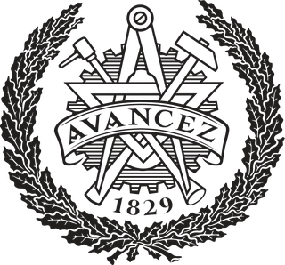
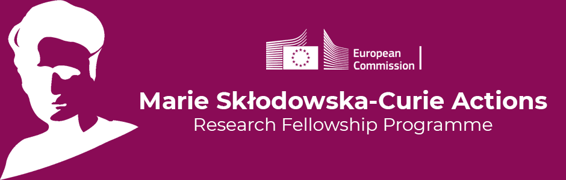

<nav class="project-jump-links" aria-label="Research projects">
  <a href="#energy-management">Energy management</a>
  <a href="#motion-control">Motion control</a>
  <a href="#assistive-robotics">Assistive robotics</a>
</nav>

<h2 class="project-section-title">Ongoing Projects</h2>
<article class="research-project-card" id="energy-management" aria-labelledby="energy-title">
  <header class="project-card-header">
    

      <h3 class="project-title" id="energy-title">Smart home energy management</h3>
      
Integrating reinforcement learning and predictive control

      
Chalmers University of Technology, Sweden European Commission · Marie Skłodowska-Curie Postdoctoral Fellowship Project ID: EC/HE/101110832

    

    

      
      
    

  </header>
  <figure class="project-overview">
    
  </figure>
  
To achieve carbon neutrality and reduce dependence on fossil energy, solar panels, heat pumps and electric vehicles (EVs) are becoming commonplace in European homes. The abundant solar power, geothermal energy, as well as environmentally friendly electric vehicles, reduce the usage of fossil-based energy, while posing challenges to the home energy management system at the same time due to the intermittent feature of renewable energy and potential battery degradation from EVs. This Marie Skłodowska-Curie Postdoctoral Fellowship will propose a smart home management system to optimise the entire home energy cost while considering a set of constraints related to battery safety and reliability, driver/household demand, and actuator.

</article>

<h2 class="project-section-title">Finished Projects</h2>
<article class="research-project-card" id="motion-control" aria-labelledby="motion-title">
  <header class="project-card-header">
    

      <h3 class="project-title" id="motion-title">Error-bounded motion control for precision manufacturing</h3>
      
University of Melbourne and ANCA Motion, Australia

    

    

      
      
    

  </header>
  
This project develops error-bounded tracking and contouring control for industrial machines with structural flexibility. The point-to-point and sinusoidal experiments compare the proposed model predictive controller with cascaded PI control on an ANCA Motion LinX® linear-motor test bench.

  <h4 class="project-experiment-title" id="point-to-point-movement">Point-to-point movement</h4>
  <figure class="project-video-figure">
    <video class="project-comparison-video" controls muted loop playsinline preload="metadata" data-preview-autoplay poster="../images/motion-control-point-to-point-poster.jpg" aria-label="Point-to-point tracking: error-bounded MPC and cascaded PI control" aria-describedby="ptp-caption">
      <source src="../assets/videos/motion-control-point-to-point.mp4" type="video/mp4" media="(min-width: 601px)">
      <source src="../assets/videos/motion-control-point-to-point-mobile.mp4" type="video/mp4">
      <a href="../assets/videos/motion-control-point-to-point.mp4">Download the comparison video.</a>
    </video>
    <figcaption id="ptp-caption">Point-to-point movement on the LinX® test bench, reported in <a href="https://doi.org/10.1109/TIE.2019.2949521">IEEE TIE, 2020</a>. The clips are aligned to the first visible carriage motion and played at their original speed.</figcaption>
  </figure>
  <h4 class="project-experiment-title" id="sinusoidal-tracking">Sinusoidal tracking</h4>
  <figure class="project-video-figure">
    <video class="project-comparison-video" controls muted loop playsinline preload="metadata" data-preview-autoplay poster="../images/motion-control-sinusoidal-poster.jpg" aria-label="Sinusoidal tracking: error-bounded MPC and cascaded PI with a notch filter" aria-describedby="sinusoidal-caption">
      <source src="../assets/videos/motion-control-sinusoidal.mp4" type="video/mp4" media="(min-width: 601px)">
      <source src="../assets/videos/motion-control-sinusoidal-mobile.mp4" type="video/mp4">
      <a href="../assets/videos/motion-control-sinusoidal.mp4">Download the comparison video.</a>
    </video>
    <figcaption id="sinusoidal-caption">Sinusoidal tracking on the LinX® test bench, reported in <a href="https://doi.org/10.1109/TIE.2019.2949521">IEEE TIE, 2020</a>. The clips are aligned to the first visible carriage motion and played at their original speed.</figcaption>
  </figure>
  
Related publications: <a href="https://doi.org/10.1109/TIE.2019.2949521">IEEE Transactions on Industrial Electronics, 2020</a> and <a href="https://doi.org/10.1109/ICIT.2019.8755064">IEEE ICIT 2019</a>.

  <h4 class="project-experiment-title" id="biaxial-contouring">Biaxial contouring with input delay</h4>
  
The related biaxial contouring study accounts for structural flexibility and input delay, with experimental validation on an ANCA Motion AM-LAB 2000 back-to-back motor hardware-in-the-loop platform. The motor implements the X axis; the Y axis and structural flexibility are emulated, and the end-effector contour is reconstructed from the experimental HIL states.

  <figure class="project-video-figure">
    <video class="project-comparison-video project-contouring-video" controls muted loop playsinline preload="metadata" data-preview-autoplay poster="../images/motion-control-contouring-poster.jpg" aria-label="X-axis motor HIL experiment and reconstructed XY contour" aria-describedby="contouring-caption">
      <source src="../assets/videos/motion-control-contouring.mp4" type="video/mp4" media="(min-width: 601px)">
      <source src="../assets/videos/motion-control-contouring-mobile.mp4" type="video/mp4">
      <a href="../assets/videos/motion-control-contouring.mp4">Download the comparison video.</a>
    </video>
    <figcaption id="contouring-caption">AM-LAB 2000 back-to-back motor HIL experiment and XY contour reconstructed from experimental states. Approximately aligned using the X-axis motion; the animation retains its original 0–8 s experimental timeline. Reported in <a href="https://doi.org/10.1109/TIE.2026.3711431">IEEE TIE, 2026</a>.</figcaption>
  </figure>
  
Related publication: <a href="https://doi.org/10.1109/TIE.2026.3711431">Contouring Error Bounded Control for Biaxial Systems With Structural Flexibility and Input Delay</a>, IEEE Transactions on Industrial Electronics, 2026.

</article>

<article class="research-project-card" id="assistive-robotics" aria-labelledby="robotics-title">
  <header class="project-card-header">
    

      <h3 class="project-title" id="robotics-title">Intelligent human–robot interfaces for assistive robots</h3>
      
Rehabilitation Research Institute of Singapore Nanyang Technological University, Singapore A*STAR and National Robotics Programme, Singapore

    

    

      
      
    

  </header>
  
This work investigates responsive human–robot interaction for mobile balance assistance and upper-limb assistive robots. Disturbance observers and nonlinear control improve the mobile robot's response to the user's movement. The upper-limb assistive robotics work includes collaboration with ETH Zurich.

  <figure class="project-overview">
    
  </figure>

  <h4 class="project-experiment-title" id="ntu-walking">Mobile balance assistance: walking and direction changes</h4>
  <figure class="project-video-figure">
    <video class="project-comparison-video" controls muted loop playsinline preload="metadata" data-preview-autoplay poster="../images/ntu-walking-comparison-poster.jpg" aria-label="Walking trials: PID control and nonlinear control, with participant faces blurred" aria-describedby="walking-caption">
      <source src="../assets/videos/ntu-walking-comparison.mp4" type="video/mp4" media="(min-width: 601px)">
      <source src="../assets/videos/ntu-walking-comparison-mobile.mp4" type="video/mp4">
      <a href="../assets/videos/ntu-walking-comparison.mp4">Download the comparison video.</a>
    </video>
    <figcaption id="walking-caption">Separate PID and nonlinear-control trials during walking and direction changes, shown at original speed. Both clips start together and loop over 26.9 s. Participant faces are blurred.</figcaption>
  </figure>
  <h4 class="project-experiment-title" id="ntu-turning">Mobile balance assistance: direction changes</h4>
  <figure class="project-video-figure">
    <video class="project-comparison-video" controls muted loop playsinline preload="metadata" data-preview-autoplay poster="../images/ntu-turning-comparison-poster.jpg" aria-label="Direction-change trials: PID control and nonlinear control, with participant faces blurred" aria-describedby="turning-caption">
      <source src="../assets/videos/ntu-turning-comparison.mp4" type="video/mp4" media="(min-width: 601px)">
      <source src="../assets/videos/ntu-turning-comparison-mobile.mp4" type="video/mp4">
      <a href="../assets/videos/ntu-turning-comparison.mp4">Download the comparison video.</a>
    </video>
    <figcaption id="turning-caption">Illustrative direction-change trials comparing PID and nonlinear control, played at their original speed. Participant faces are blurred. Each pair uses a single player so both clips finish together.</figcaption>
  </figure>
  
Related publication: <a href="https://www.sciencedirect.com/science/article/pii/S2405896323021262">Graceful User Following for Mobile Balance Assistive Robot in Daily Activities Assistance</a>, IFAC World Congress, 2023.

  <h4 class="project-experiment-title" id="robotics-media">Media coverage</h4>
  
Coverage of the Mobile Robotic Balance Assistant (MRBA) developed at RRIS:

  

    <a href="https://www.mobihealthnews.com/news/asia/wearable-assistive-robot-developed-prevent-falls-singapores-elderly">MobiHealthNews</a>
    <a href="https://www.straitstimes.com/singapore/wearable-robot-detects-and-prevents-falls-especially-in-the-elderly-reducing-reliance-on-caregivers">The Straits Times</a>
  

  

    <figure class="project-media-item">
      <iframe src="https://www.youtube-nocookie.com/embed/RYbT55M-enQ" title="MRBA on Mediacorp Channel 5 News, 18 April 2022" loading="lazy" allow="accelerometer; clipboard-write; encrypted-media; gyroscope; picture-in-picture; web-share" allowfullscreen></iframe>
      <figcaption>Channel 5 News · 18 April 2022</figcaption>
    </figure>
    <figure class="project-media-item">
      <iframe src="https://www.youtube-nocookie.com/embed/94lCCmNR0hU" title="MRBA on Mediacorp Channel 8 News, 7 September 2022" loading="lazy" allow="accelerometer; clipboard-write; encrypted-media; gyroscope; picture-in-picture; web-share" allowfullscreen></iframe>
      <figcaption>Channel 8 News · 7 September 2022</figcaption>
    </figure>
  

</article>

